# Punto de Venta Dolorense — Caja con SQLite local, construida con TDD

App de **punto de venta** en **Flutter** construida con **TDD (Rojo → Verde → Refactor)** para un negocio
de Dolores Hidalgo (nieves, dulces, Talavera…). Guarda productos y ventas en **SQLite** dentro del
teléfono, así que funciona sin internet.

- **Materia:** Desarrollo Móvil Integral — UTNG
- **Profesor:** Anastacio Rodríguez García

---

## ¿Qué hace?

| Parte | Qué hace |
|---|---|
| 💵 **Dinero** | Todo en **centavos enteros** (nada de `double`), con formato `$1,234.56`. |
| 📦 **Productos** | Código único, nombre, precio y existencias, guardados en SQLite. |
| 🛒 **Carrito** | Suma cantidades, no vende más de lo que hay y desglosa el **IVA 16 %**. |
| 💳 **Cobrar** | Calcula el cambio y guarda la venta en una **transacción**: o se guarda todo o nada. |
| 📊 **Corte del día** | Número de ventas, total e IVA del día. |
| ⚠️ **Bajo inventario** | Lista los productos con 5 piezas o menos. |

---

## Estructura del proyecto

```
punto_venta_dolores/
├─ lib/
│  ├─ dominio/        dinero, excepciones, producto, carrito, venta (Dart puro)
│  ├─ datos/          base_datos, repositorio_productos, repositorio_ventas (SQLite)
│  ├─ presentacion/   caja_viewmodel, pantalla_caja
│  └─ main.dart
├─ test/
│  ├─ dominio_test.dart    (11 pruebas: Dinero, Producto, Carrito)
│  └─ datos_test.dart      (6 pruebas: SQLite en memoria)
├─ capturas/               evidencias del ciclo rojo / verde, ronda por ronda
├─ paso1_ROJO.ps1
├─ paso2_VERDE.ps1
└─ pubspec.yaml
```

**17 pruebas en total.**

Paquetes: `sqflite`, `path` y, solo para pruebas, `sqflite_common_ffi` (SQLite en la computadora).

---

## Cómo ejecutarlo

En PowerShell, dentro de la carpeta `punto_venta_dolores`:

```powershell
flutter create .
Remove-Item test\widget_test.dart
flutter pub get
flutter test
```

Para abrir la app usa el **emulador o un celular Android** (SQLite no funciona en el navegador):

```powershell
flutter devices
flutter run -d emulator-5554
```

Prueba rápida: toca "Nieve de limón" dos veces, escribe `100` en "Paga con $" y toca **Cobrar**.
Debe salir "Cambio: $50.00" y las existencias bajar de 40 a 38.

> Los datos se quedan guardados aunque cierres la app. Para empezar de cero, desinstala la app.

---

## Ciclo TDD — Evidencias

🔴 **ROJO:** se escribe la prueba primero; falla porque el código todavía no existe.
🟢 **VERDE:** se escribe el código mínimo para que la prueba pase.
🔵 **REFACTOR:** se ordena el código sin romper las pruebas.

### Ronda 1 · El dinero en centavos
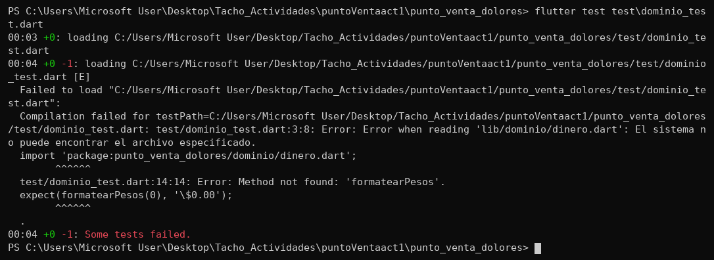
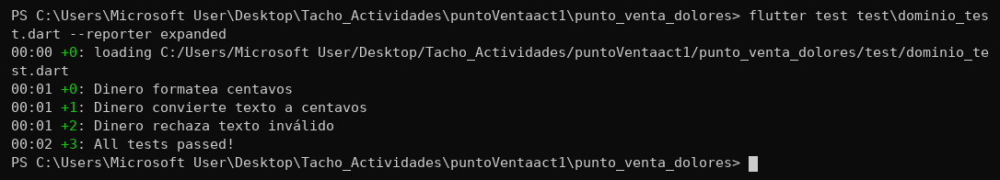

### Ronda 2 · El producto
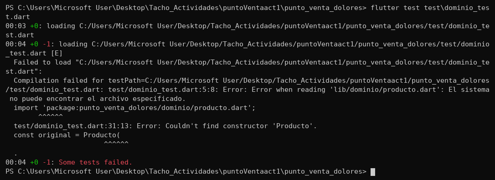
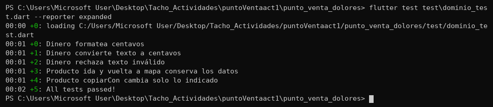

### Ronda 3 · El carrito (existencias, IVA y cambio)
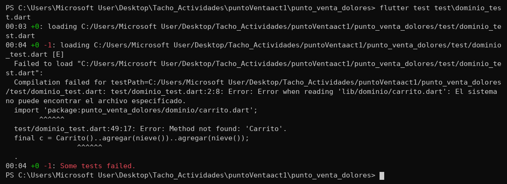
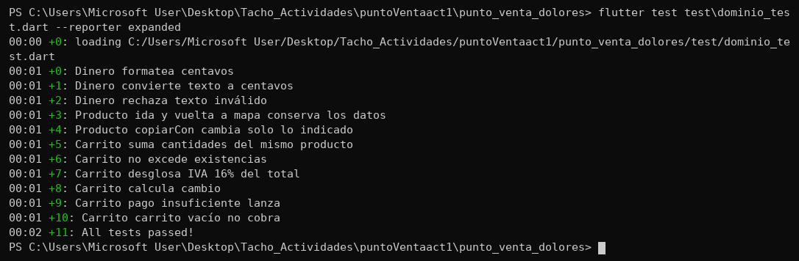

### Ronda 4 · SQLite: guardar y buscar productos
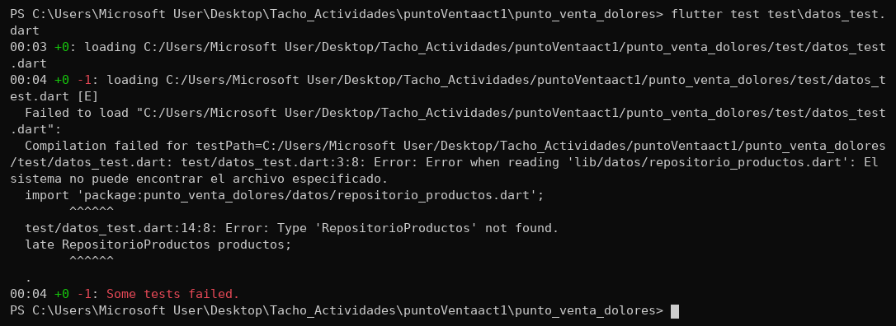
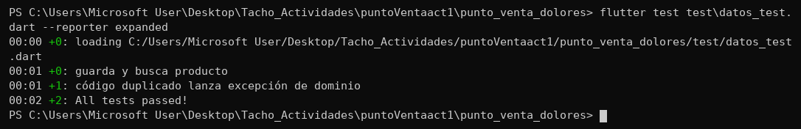

### Ronda 5 · Cobrar con transacción, corte del día y bajo inventario
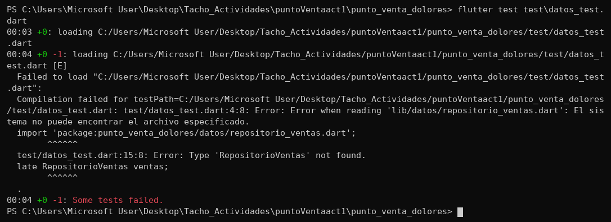
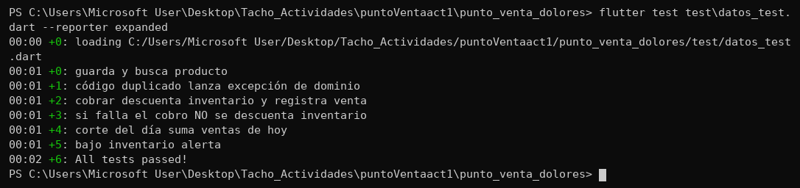

### Todas las pruebas
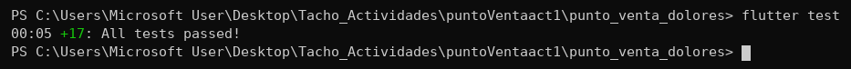

---

## Checklist de calidad

- [x] Todo el dinero está en centavos enteros; ningún `double` en el dominio.
- [x] El dominio no importa Flutter ni sqflite.
- [x] Cada regla de negocio nació de una prueba roja.
- [x] Cobrar usa una transacción y se probó el caso de fallo.
- [x] Los errores técnicos se traducen a excepciones de negocio con mensaje claro.
- [x] La pantalla no contiene reglas de negocio.
- [x] `flutter test` termina completamente en verde.
